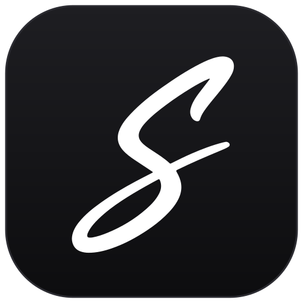
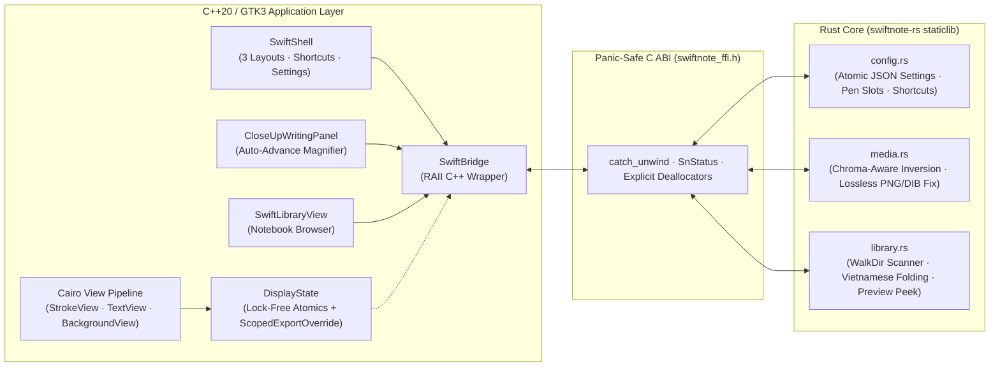

<div align="center">

<picture>
  <source media="(prefers-color-scheme: dark)" srcset="assets/swiftnote-logo-dark.svg">
  <source media="(prefers-color-scheme: light)" srcset="assets/swiftnote-logo.svg">
  
</picture>

# Swift note

**Calm, tactile, canvas-first handwriting & PDF annotation — built on a hybrid C++20/GTK3 + Rust architecture.**

[](https://github.com/nguyennguyenplus-source/swiftnote-ink/actions/workflows/ci-swiftnote.yml)
[](docs/ARCHITECTURE.md)
[](docs/ARCHITECTURE.md#5-zero-duplication-3-layout-gtk3-shell)
[-059669?style=flat)](#installation--building-from-source)
[](LICENSE)

[Key Features](#key-features) • [Comparison](#comparison) • [Architecture](#hybrid-architecture) • [Shortcuts](#keyboard-shortcuts) • [Build & Test](#installation--building-from-source) • [Limitations & Roadmap](#current-limitations--breakthrough-roadmap)

</div>

---

## Overview

**Swift note** is an engineered fork of [Xournal++](https://github.com/xournalpp/xournalpp) (`1.3.8+dev`) that pairs Xournal++'s battle-tested vector ink, stylus pressure, geometry, and PDF annotation engine with a quiet, distraction-free workspace inspired by **Scrble Ink** and modern native design systems — backed by a memory-safe **Rust** core (`swiftnote-rs`) linked over a strict C ABI.

Traditional desktop note-taking tools force a trade-off: either rich open-source engines buried under dense legacy toolbars, or sleek closed-source UWP apps locked to one OS with limited PDF and vector capabilities. **Swift note** bridges that gap while preserving **100% file compatibility** with standard `.xopp` documents.

---

## Key Features

- **3 Switchable Canvas-First Layouts**
  - **Pure Top Bar** — Clean single-row header toolbar for desktop clarity.
  - **Canvas Pill** *(default)* — Minimal floating pill chrome that maximizes uninterrupted writing space.
  - **Zen Bottom Dock** — Thumb- and stylus-friendly bottom dock for tablets and 2-in-1 laptops.
  - Clean solid surfaces, calibrated Light/Dark contrast, `Plus Jakarta Sans` typography, and hidden legacy status/search chrome.
- **Non-Destructive Blackboard Mode & Dual PDF Export**
  - Switch any light notebook or ruled sheet into a matte chalkboard (`#16181D`) with a single key (`B`).
  - Chroma-preserving display inversion automatically flips achromatic ink (black/charcoal ↔ white) while leaving colored math/study ink (blue, red, green, yellow highlighters) intact.
  - Export **either** a clean printable white-paper PDF **or** the Blackboard dark look via an RAII `ScopedExportOverride` — without ever mutating saved strokes.
- **Quick Pen Slots & Auto-Return Eraser**
  - Up to 10 customizable pen/highlighter slots (color, stroke width, pressure sensitivity, solid/dashed/dotted style, Ink-to-Shape) accessible via `1`–`5`.
  - Optional **Auto-Return Eraser** automatically switches back to your active pen the instant an erase stroke finishes.
- **Scrble Ink-Style Single-Key Shortcuts & Visual 4-Tab Settings**
  - Ergonomic single-key bindings (`E` Eraser, `L` Lasso, `R` Setsquare, `C` Compass, `T` Text, `B` Blackboard, `Z` Close-Up, `Tab` Focus Mode) with conflict-free live rebinding.
  - Unified 4-tab visual Settings dialog (**Appearance**, **Pens & Ink**, **Shortcuts**, **Canvas & Library**).
- **Close-Up Auto-Advance Writing Panel (`Z`)**
  - Docked magnified writing strip (`2.5×` default zoom) with automatic margin-triggered line advancement so handwriting stays crisp on compact laptop or tablet screens.
- **Vietnamese Diacritic-Insensitive Library & Instant Previews**
  - Rust-powered notebook browser scanning `.xopp`, `.xoj`, and `.pdf` files with real-time diacritic-folded search (e.g. `"giai tich"` matches `"Giải tích 1.xopp"`), folder tree, and streamed `<preview>` thumbnail extraction.
- **Lossless Clipboard Image Pipeline**
  - Native Rust PNG/DIB normalization repairs the notorious Windows 32-bit `CF_DIB` all-zero alpha quirk without corrupting genuinely transparent PNGs.
- **Built-In Study Templates & Precision Tools**
  - One-click **Cornell Notes**, Ruled, Dotted, Graph, and Blank templates alongside full Xournal++ Setsquare, Compass, LaTeX, Audio recording, and Poppler PDF annotation support.

---

## Comparison

| Capability | Upstream Xournal++ | Scrble Ink | **Swift note** |
| :--- | :---: | :---: | :---: |
| Cross-Platform (Windows + Linux Wayland/X11) | ✅ | ❌ *(Windows only)* | ✅ |
| Open-Source (GPL-2.0) & Open `.xopp` Format | ✅ | ❌ | ✅ |
| Canvas-First Minimal UI (3 Switchable Layouts) | ❌ *(Legacy multi-bar)* | ✅ | ✅ |
| Non-Destructive Blackboard + Printable PDF Export | ❌ | ⚠️ *(Limited)* | ✅ |
| Single-Key Ergonomic Shortcuts + Live Rebinding UI | ❌ | ✅ | ✅ |
| Auto-Return Eraser & Quick Pen Slot Presets | ⚠️ *(Manual plugin)* | ✅ | ✅ |
| Close-Up Auto-Advance Writing Panel | ❌ | ❌ | ✅ |
| Vietnamese Diacritic-Insensitive Notebook Library | ❌ | ❌ | ✅ |
| Win32 `CF_DIB` Zero-Alpha Lossless Image Paste Fix | ❌ | ✅ | ✅ |
| Precision Setsquare, Compass, PDF & LaTeX Engine | ✅ | ❌ | ✅ |

---

## Hybrid Architecture

**Swift note** isolates UI/rendering orchestration (C++20/GTK3) from stateful persistence, media normalization, and filesystem indexing (Rust `staticlib`) across a panic-safe C ABI boundary (`swiftnote_ffi.h`).



> For module maps, FFI memory-ownership invariants, Cairo `Mask` safety hardening, and the testing pyramid, read the full **[Architecture Specification](docs/ARCHITECTURE.md)**.

---

## Keyboard Shortcuts

All shortcuts work out-of-the-box and are automatically suppressed when typing inside a Text Box or open popover. Every binding can be customized in **Settings → Shortcuts**.

| Key | Action | Key | Action |
| :---: | :--- | :---: | :--- |
| `1` – `5` | Select Quick Pen Slot 1–5 (Pen / Highlighter) | `V` | Vertical Space Tool |
| `E` | Eraser *(press again or finish stroke to return)* | `P` | Laser Pointer |
| `L` | Freehand Lasso Selection | `H` | Hand / Pan Mode |
| `S` | Rectangular Box Selection | `B` | Toggle Non-Destructive Blackboard |
| `G` | Geometry / Ink-to-Shape | `Z` | Toggle Close-Up Writing Panel |
| `T` | Text Box Tool | `N` | Append New Page |
| `R` | Setsquare & Protractor Overlay | `D` | Toggle Light / Dark Theme |
| `C` | Compass Overlay | `Tab` / `F` | Focus Mode (Hide Chrome) / Fullscreen |

---

## Installation & Building from Source

### Prebuilt CI Artifacts

Every push to `main` builds, tests, and uploads ready-to-run artifacts via [GitHub Actions](https://github.com/nguyennguyenplus-source/swiftnote-ink/actions/workflows/ci-swiftnote.yml):

- **Windows 10/11 (x64 Portable):** Download `swiftnote-windows-portable` and launch `SwiftNote.exe`.
- **Linux Ubuntu 24.04 (Wayland & X11):** Download `swiftnote-linux-ubuntu2404` (`.deb` installer or `.tar.gz` archive).

### Building on Windows (MSYS2 UCRT64)

```bash
# 1. Install dependencies in MSYS2 UCRT64 shell
pacman -S --needed \
  mingw-w64-ucrt-x86_64-toolchain mingw-w64-ucrt-x86_64-cmake mingw-w64-ucrt-x86_64-ninja \
  mingw-w64-ucrt-x86_64-gtk3 mingw-w64-ucrt-x86_64-poppler mingw-w64-ucrt-x86_64-poppler-data \
  mingw-w64-ucrt-x86_64-librsvg mingw-w64-ucrt-x86_64-libzip mingw-w64-ucrt-x86_64-qpdf \
  mingw-w64-ucrt-x86_64-libsndfile mingw-w64-ucrt-x86_64-portaudio mingw-w64-ucrt-x86_64-lua \
  mingw-w64-ucrt-x86_64-gtksourceview4 mingw-w64-ucrt-x86_64-imagemagick \
  mingw-w64-ucrt-x86_64-gettext mingw-w64-ucrt-x86_64-rust mingw-w64-ucrt-x86_64-gtest

# 2. Configure & build Swift note + test suites
cmake -B build-ucrt64 -G Ninja -DCMAKE_BUILD_TYPE=RelWithDebInfo -DENABLE_GTEST=ON -DENABLE_CPPTRACE=OFF
cmake --build build-ucrt64 --target xournalpp test-units test-gtk-integration --parallel

# 3. Package portable Windows bundle (optional)
bash windows-setup/package-swiftnote-portable.sh build-ucrt64 ./dist-swiftnote
```

### Building on Linux (Ubuntu 24.04 / Debian)

```bash
# 1. Install build dependencies + Rust stable toolchain
sudo apt-get update && sudo apt-get install -y \
  cmake ninja-build g++ pkg-config gettext help2man lsb-release xvfb \
  libgtk-3-dev libfontconfig-dev libpoppler-glib-dev poppler-data \
  libxml2-dev libzip-dev librsvg2-dev libsndfile1-dev portaudio19-dev \
  liblua5.4-dev libgtksourceview-4-dev libqpdf-dev libgtest-dev \
  libx11-dev libxi-dev libxext-dev

# 2. Configure, build & package (.deb + .tar.gz)
cmake -B build -G Ninja -DCMAKE_BUILD_TYPE=RelWithDebInfo -DENABLE_GTEST=ON -DENABLE_CPPTRACE=OFF -DCPACK_GENERATOR="DEB;TGZ"
cmake --build build --parallel
cmake --build build --target test-units test-gtk-integration --parallel
(cd build && cpack -G "DEB;TGZ")
```

### Verification Suite

```bash
# Rust unit tests & strict zero-warning Clippy lint
cargo test --manifest-path rust/swiftnote-rs/Cargo.toml
cargo clippy --manifest-path rust/swiftnote-rs/Cargo.toml --all-targets -- -D warnings

# C++ unit test suite (119 test cases)
./build-ucrt64/test/test-units.exe --gtest_brief=1            # Windows
./build/test/test-units --gtest_brief=1                       # Linux

# End-to-end GTK3 regression suite (shell chrome, alpha, rulers, text box)
./build-ucrt64/test/test-gtk-integration.exe --gtest_filter=SwiftShellRegressionTest.*
xvfb-run -a ./build/test/test-gtk-integration --gtest_filter=SwiftShellRegressionTest.*
```

---

## Current Limitations & Breakthrough Roadmap

Building **Swift note v1.0** on top of Xournal++ exposed concrete structural ceilings inherited from the upstream C++/GTK3/Cairo stack. Rather than hiding these constraints, we document them rigorously and use them to drive our **v1.1 → v2.0** engineering roadmap.

### Honest Assessment of Current Limitations (v1.0)

| Domain | Observed Bottleneck (Xournal++ & Swift note v1.0) | Impact on Users |
| :--- | :--- | :--- |
| **Rendering Pipeline** | CPU-only Cairo software rasterization (`RenderJob` + full-page `ARGB32` `Mask`) | High RAM on 4K/HiDPI monitors; frame drops on dense PDFs or 120–240Hz styluses |
| **Concurrency** | Single-threaded background `Scheduler` serializes page rasterization | Visible blank tiles during rapid multi-page textbook scrolling |
| **Platform Toolkit** | Legacy GTK3 on Windows & Wayland | Wayland fractional-scaling blur; Windows IME preedit quirks with Vietnamese tools (Unikey/EVKey); modal popover grab fragility |
| **Persistence** | Monolithic Gzip-XML `.xopp` rewrites the entire file on every save (`O(N)`) | Autosave stutter on 100+ page notebooks; incompatible with conflict-free sync |
| **Ink Intelligence** | Strokes are purely geometric vectors without semantic indexing | No offline handwriting search (especially Vietnamese diacritics) or Ink-to-LaTeX math conversion |
| **Workspace Model** | Paginated-only single-pane canvas | No infinite whiteboard for derivations/mind-maps; no side-by-side Split PDF + Notes view |
| **Multi-Device Sync** | Local filesystem only | No built-in encrypted cross-device replication or conflict resolution |
| **Stylus Physics** | Fixed Cairo stroke caps without tilt/azimuth shaders or latency prediction | Noticeable nib-to-ink lag on 120Hz+ displays; limited graphite/fountain brush realism |

### Breakthrough Upgrade Roadmap (v1.1 → v2.0)

| Release | Theme | Key Engineering Breakthroughs |
| :--- | :--- | :--- |
| **v1.1** | **Tactile Ink & Platform Polish** | Kalman / damped-spring stylus latency prediction; tilt/azimuth pencil & fountain shaders; native Win32 TSF/IME preedit bridge for Vietnamese input; persistent per-note viewport state. |
| **v1.2** | **Local-First Offline AI (ONNX in Rust)** | Pure-offline ONNX Runtime (`ort`) stroke recognizer for **Ink-to-LaTeX** math and **Vietnamese HTR**; background SQLite FTS5 semantic search across all handwritten notes — zero cloud telemetry. |
| **v1.3** | **Incremental `.swnote` & E2EE CRDT Sync** | Content-addressed SQLite + WAL storage (`O(Δ)` `< 2 ms` autosave) with lossless `.xopp` bidirectional import/export; **Automerge/Loro CRDT** op-log encrypted with `XChaCha20-Poly1305` (WebDAV / S3 / LAN P2P). |
| **v2.0** | **GPU `wgpu` Engine & Hybrid Canvas** | Rust GPU tile renderer (`wgpu`/Vello) targeting `< 8 ms` motion-to-photon at 120Hz+; GTK4 / native compositor migration; **Split-View PDF + Cornell Notes**; **Hybrid Infinite Canvas** with printable frame anchors; Audio-Ink 2.0 (offline Whisper stroke-linked transcripts). |

> Read the complete engineering critique, data structures, crate/library design, and target KPI benchmarks in **[`docs/ROADMAP.md`](docs/ROADMAP.md)**.

---

## Documentation Index

- **[`docs/ARCHITECTURE.md`](docs/ARCHITECTURE.md)** — Hybrid C++20/Rust FFI boundary, lock-free display pipeline, lossless clipboard repair, and reliability hardening.
- **[`docs/ROADMAP.md`](docs/ROADMAP.md)** — Deep analysis of Xournal++ & Swift note limitations paired with technical blueprints for v1.1 → v2.0.
- **[`CHANGELOG.md`](CHANGELOG.md)** — Release history for Swift note and upstream Xournal++ lineage.
- **[`CONTRIBUTING.md`](CONTRIBUTING.md)** — Development workflow, coding standards, design invariants, and verification gates.

---

## Upstream Attribution & License

**Swift note** is a derivative work of **[Xournal++](https://github.com/xournalpp/xournalpp)** (branched from `1.3.8+dev`), which in turn builds upon the original Xournal stroke recognizer. We gratefully acknowledge the Xournal++ maintainers and contributors — see [`AUTHORS`](AUTHORS) for the complete upstream contributor list.

- **License:** Distributed under the **GNU General Public License v2.0 or later (`GPL-2.0-or-later`)** — see [`LICENSE`](LICENSE) and [`copyright.txt`](copyright.txt) for complete per-file and third-party dependency attributions.
- **Typography:** Ships with [Plus Jakarta Sans](https://github.com/tokotype/PlusJakartaSans) under the **SIL Open Font License 1.1** — see [`ui/fonts/OFL.txt`](ui/fonts/OFL.txt).
- **Iconography:** Toolbar glyphs inspired by clean geometric vector sets (Lucide ISC / custom SVG).
