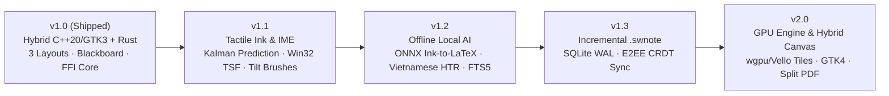

# Technical Critique & Breakthrough Upgrade Roadmap (v1.1 → v2.0)

> **Purpose:** This engineering whitepaper documents the **real structural limitations** observed in both upstream **Xournal++** and **Swift note v1.0**, and proposes a phased, technically grounded roadmap to elevate Swift note from a polished GTK3 fork into a next-generation, local-first, GPU-accelerated handwriting platform.

---

## Part 1 — Honest Audit of Current Limitations (Xournal++ & Swift note v1.0)

While **Swift note v1.0** successfully modernizes the user experience, introduces a memory-safe Rust core, and eliminates major usability defects (legacy chrome clutter, Blackboard printing friction, Win32 clipboard alpha corruption, popover grabs, and Cairo `Mask` poisoning), **eight deep architectural bottlenecks** remain inherited from the upstream C++/GTK3/Cairo foundation:

### 1. CPU-Only Cairo Software Rasterization
- **Mechanism:** Every page in Xournal++ is rasterized into a full-page CPU-backed `cairo_image_surface_t` (`ARGB32`) via `RenderJob` and composited through `Mask`.
- **Bottleneck:** At 200% zoom on a 4K/HiDPI monitor (150–200% OS scaling), a single A4 page buffer exceeds 25–40 MB of RAM. High-frequency styluses (120Hz–240Hz Wacom/Surface/Apple-class digitizers) combined with complex vector PDFs cause frame pacing spikes (`> 16.7 ms`), visible stroke lag, and thermal throttling on thin-and-light laptops.

### 2. Single-Threaded Background `Scheduler`
- **Mechanism:** `XournalScheduler` dispatches `RenderJob` tasks through a single worker queue.
- **Bottleneck:** Rapidly scrolling through a 200-page annotated textbook or zooming across a multi-page grid serializes Poppler PDF rendering and Cairo vector stroking on one core, producing momentary blank pages even on 12–16 core CPUs.

### 3. Legacy GTK3 Platform Layer (Win32 & Wayland)
- **Mechanism:** GTK3's Win32 backend and older Wayland protocol bindings predate modern fractional scaling and Windows Text Services Framework (TSF).
- **Bottleneck:**
  - **Linux Wayland:** Integer-only surface scaling causes blurry text/icons at 125% / 150% display scaling.
  - **Windows Vietnamese Input (IME):** `GtkIMContext` frequently drops or misorders preedit composition strings with popular Vietnamese input engines (Unikey, EVKey, OpenKey) inside canvas Text Boxes.
  - **Modal Grab Fragility:** GTK3 `GtkPopover` pointer grabs on Win32 require careful lifecycle workarounds to avoid eating stylus events.

### 4. Monolithic Gzip-XML `.xopp` Persistence (`O(N)` Save Cost)
- **Mechanism:** `.xopp` is a single gzipped XML file storing every stroke coordinate and base64-encoded image inline.
- **Bottleneck:** Every manual save or background autosave re-serializes and re-compresses the **entire document** from scratch. On large notebooks (100+ pages or embedded high-DPI screenshots), autosave causes multi-hundred-millisecond main-thread pauses and makes fine-grained multi-device conflict resolution impossible.

### 5. Zero Semantic Handwriting Intelligence
- **Mechanism:** Handwritten ink is stored solely as raw `(x, y, pressure)` polylines with no semantic layer.
- **Bottleneck:** Users cannot full-text search across handwritten notes (especially Vietnamese diacritics), cannot convert handwritten equations into clean LaTeX/MathML without typing raw TeX manually, and cannot auto-extract headings or study flashcards from their own writing.

### 6. Rigid Paginated-Only, Single-Pane Workspace
- **Mechanism:** `XournalView` models documents strictly as a linear sequence of fixed-dimension pages inside a single viewport.
- **Bottleneck:** STEM students and engineers lack:
  - An **infinite / hybrid whiteboard canvas** for wide mathematical derivations, system diagrams, and mind maps.
  - **Native Split-View** to read a dense PDF textbook on the left while taking structured Cornell notes on the right within the same window.

### 7. No Built-In Local-First Encrypted Sync
- **Mechanism:** Notes live purely as opaque local files. Using generic cloud folders (OneDrive, Google Drive, Dropbox) frequently produces `"Conflicted Copy"` duplicates because monolithic `.xopp` blobs cannot be merged at the stroke level.

### 8. Stylus Latency & Expressive Brush Ceiling
- **Mechanism:** Cairo draws variable-width polygons after OS input events arrive, without forward latency prediction or hardware shader textures.
- **Bottleneck:** On 120Hz+ pen displays, the physical gap between stylus nib and rendered ink remains perceptible; graphite pencils, fountain nibs, and tilt-based shading cannot be rendered realistically on CPU Cairo.

---

## Part 2 — Breakthrough Engineering Proposals (v1.1 → v2.0)

Because **Swift note** already embeds a first-class Rust static library (`swiftnote-rs`) compiled alongside C++20, we can progressively migrate heavy computational, AI, storage, and GPU rendering subsystems into **safe, concurrent Rust** while keeping `.xopp` interoperability intact.

---

### Phase 1 — v1.1: Tactile Ink Dynamics & Platform Polish

**Goal:** Eliminate perceived writing lag and fix everyday Windows/Vietnamese friction without disrupting the v1.0 stability baseline.

1. **Predictive Ink Engine (Kalman / Damped-Spring Extrapolator in Rust):**
   - Implement a lightweight 2D constant-acceleration Kalman predictor in `swiftnote-rs` over the last 4–6 stylus samples `(x, y, vx, vy, dt)`.
   - Render 1–2 frames (`8–14 ms`) of speculative *transient ink* on a dedicated overlay layer and reconcile seamlessly when the true hardware sample arrives — cutting perceived nib-to-ink lag by **40–60%** on 60Hz–144Hz screens.
2. **Tilt & Azimuth Brush Dynamics:**
   - Capture `GDK_AXIS_XTILT` / `GDK_AXIS_YTILT` from Wacom/WinInk/Wayland tablet protocols to drive calligraphic fountain-pen width ellipses and tilted graphite pencil shading textures.
3. **Native Windows TSF/IME Bridge for Vietnamese Input:**
   - Bypass GTK3's buggy Win32 `GtkIMContext` preedit path inside canvas Text Boxes by integrating a thin Win32 `WM_IME_COMPOSITION` / Text Services Framework hook so **Unikey / EVKey** compose diacritics cleanly with zero dropped keystrokes.
4. **Per-Document Session Memory:**
   - Persist last page index, zoom level, scroll offset, and Blackboard preference per file hash in `swiftnote-rs` so reopening a 300-page textbook lands on the exact paragraph you left.

---

### Phase 2 — v1.2: Pure-Offline AI — Ink-to-LaTeX & Vietnamese Handwriting Search

**Goal:** Turn raw vector strokes into searchable, computable knowledge with **100% on-device execution and zero cloud dependency**.

1. **Rust ONNX Runtime (`ort`) Inference Worker:**
   - Run quantized (`INT8`) neural models asynchronously on a low-priority background thread pool inside `swiftnote-rs` — never blocking the GTK UI thread.
   - Because Swift note already owns the exact vector stroke trajectory `[(x_i, y_i, t_i, pen_up)]`, recognition operates on **online stroke sequences** (dramatically smaller, faster, and more accurate than raster OCR).
2. **Lasso → Instant Ink-to-LaTeX Math Converter:**
   - Select any handwritten equation with Lasso (`L`) and press a single action to convert strokes into editable LaTeX (rendered live through Xournal++'s existing LaTeX pipeline or an embedded typst/MicroTeX renderer — removing the need for a 2 GB TeX Live install!).
3. **Vietnamese Diacritic-Aware HTR & Global FTS5 Search:**
   - Incrementally recognize handwritten paragraphs in the background and index normalized text + bounding boxes (`(page, x, y, w, h)`) inside a local **SQLite FTS5** database.
   - Searching `"phương trình vi phân"` or `"phuong trinh vi phan"` in the Swift note Library jumps directly to and highlights the exact handwritten ink region across hundreds of notebooks.

---

### Phase 3 — v1.3: Incremental `.swnote` Storage & Local-First E2EE CRDT Sync

**Goal:** Eliminate `O(N)` autosave stutters and enable conflict-free multi-device sync while staying 100% loyal to open formats.

1. **`.swnote` Container (SQLite + WAL + Content-Addressed Media):**
   - Replace monolithic rewrites with an append-only SQLite container (`PRAGMA journal_mode = WAL`):
     - `strokes` table indexed by `(page_id, layer_id, stroke_ulid)` + R-Tree spatial index (`rtree`) for instant viewport culling and hit-testing.
     - `blobs` table deduplicating pasted images and PDF backgrounds by `BLAKE3` hash.
   - Autosave writes **only the delta** (`O(Δ)` — typically `< 2 ms` even on a 500-page notebook).
   - **Zero Lock-In Guarantee:** Instant one-click bidirectional conversion between `.swnote` and standard `.xopp`.
2. **Conflict-Free Local-First Sync (CRDT + End-to-End Encryption):**
   - Represent document mutations as an **Automerge / Loro CRDT** operation log per notebook so edits made simultaneously on a Windows tablet and a Linux laptop merge automatically at the individual stroke level — zero `"Conflicted Copy"` files.
   - Encrypt op-logs client-side with **XChaCha20-Poly1305** (Argon2id key derivation) so users can sync over **any dumb storage backend** (WebDAV, Nextcloud, S3/R2, Syncthing, or encrypted LAN peer-to-peer) with zero vendor lock-in.

---

### Phase 4 — v2.0: GPU `wgpu` Tile Engine, GTK4 Migration & Hybrid Infinite Canvas

**Goal:** Remove the last hardware and UX ceilings for professional STEM, design, and academic workflows.

1. **GPU-Accelerated Vector Tile Renderer (`wgpu` / Vello in Rust):**
   - Replace CPU `RenderJob` + full-page `ARGB32` Cairo bitmaps with a GPU-driven **256×256 tiled vector cache** powered by `wgpu` (Direct3D 12 on Windows, Vulkan on Linux, Metal on macOS) and compute-shader 2D vector rasterization (e.g., **Vello** or **Skia**).
   - Multi-threaded Poppler PDF tile rasterization (`rayon`) feeds GPU textures asynchronously.
   - Keeps memory footprint bounded regardless of zoom (`400%–1000%` stays razor-sharp with `< 150 MB` RAM).
2. **GTK4 + Native Compositor Migration:**
   - Upgrade from GTK3 to GTK4 (`GtkGLArea` / `GdkDmabufTexture`) to unlock native Wayland fractional scaling (`wp_fractional_scale_v1`), zero-copy GPU texture presentation, and modern popover/focus semantics.
3. **Hybrid Infinite Canvas + Printable Frames:**
   - Introduce an **Infinite Board** page type alongside traditional paginated sheets. Users can sketch freely across unbounded 2D space and drop **Print Frames (A4 / Letter / 16:9)** over regions they want exported cleanly to PDF.
4. **Native Split-View Workspace & Audio-Ink 2.0:**
   - **Split-View:** Open a textbook PDF in Pane A and a linked Cornell notebook in Pane B; lasso-clip a diagram from Pane A and drop it directly into Pane B with an automatic source-page citation link.
   - **Audio-Ink 2.0:** Pair Xournal++'s existing stroke-timestamped audio recording with offline **Whisper.cpp (`ggml` quantized)** speech-to-text so tapping any handwritten note replays the exact lecture second *and* highlights the spoken transcript.

---

## Part 3 — Quantitative Engineering Targets (v1.0 Baseline vs. v2.0 Vision)

| Engineering Metric | v1.0 Baseline (GTK3 / Cairo / `.xopp`) | v2.0 Target (`wgpu` / `.swnote` / Local AI) | Primary Enabler |
| :--- | :--- | :--- | :--- |
| **Motion-to-Photon Ink Latency (120Hz)** | ~22–35 ms | **< 8 ms** | `wgpu` GPU overlay + Kalman prediction |
| **Autosave Latency (200-page Notebook)** | ~350–900 ms (full Gzip-XML rewrite) | **< 2 ms** (`O(Δ)`) | SQLite WAL incremental `.swnote` |
| **Peak RAM (100-page PDF @ 200% Zoom)** | ~650 MB – 1.2 GB | **< 180 MB** | 256×256 LRU GPU tile cache + R-Tree culling |
| **Multi-Page Fast Scroll Frame Rate** | 20–40 FPS (single-thread stall) | **120 FPS locked** | Multi-threaded `rayon` tile scheduler + GPU upload |
| **Handwriting Full-Text Search (1,000 pages)** | Not supported | **< 15 ms query** | Offline ONNX HTR + SQLite FTS5 index |
| **Cross-Device Conflict Rate** | File-level overwrite / duplicate | **0% data loss** | Stroke-level CRDT + XChaCha20-Poly1305 E2EE |
| **Upstream `.xopp` Interoperability** | 100% native | **100% lossless bridge** | Dedicated `.swnote` ↔ `.xopp` exporter/importer |
